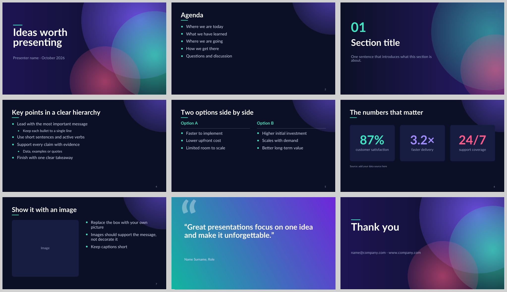
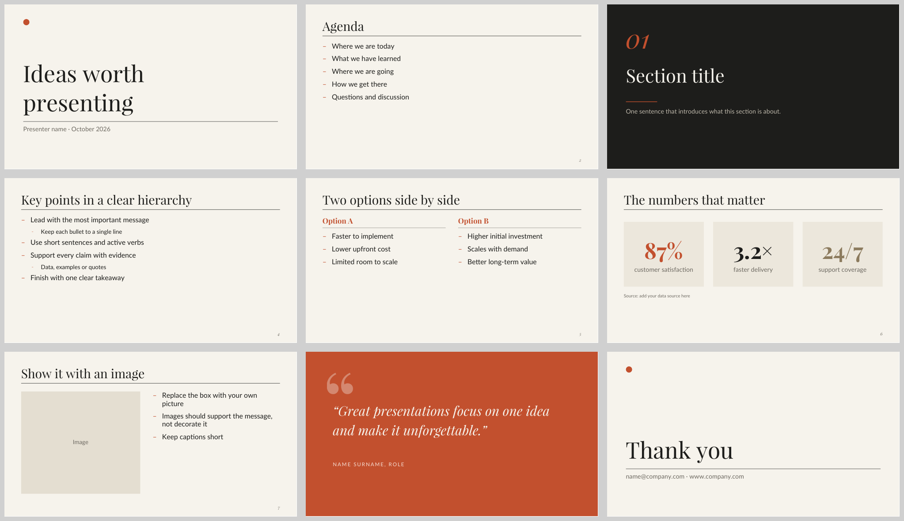
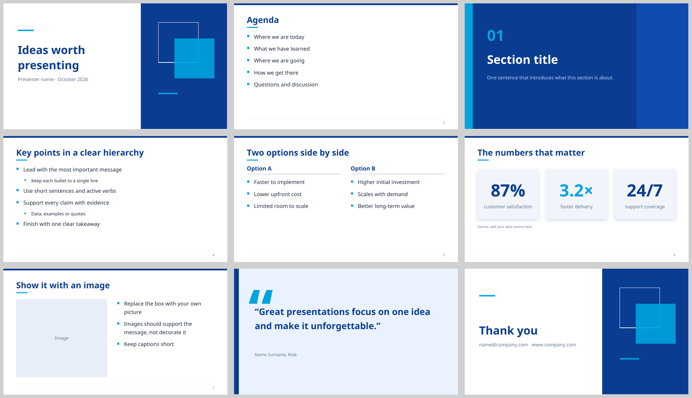
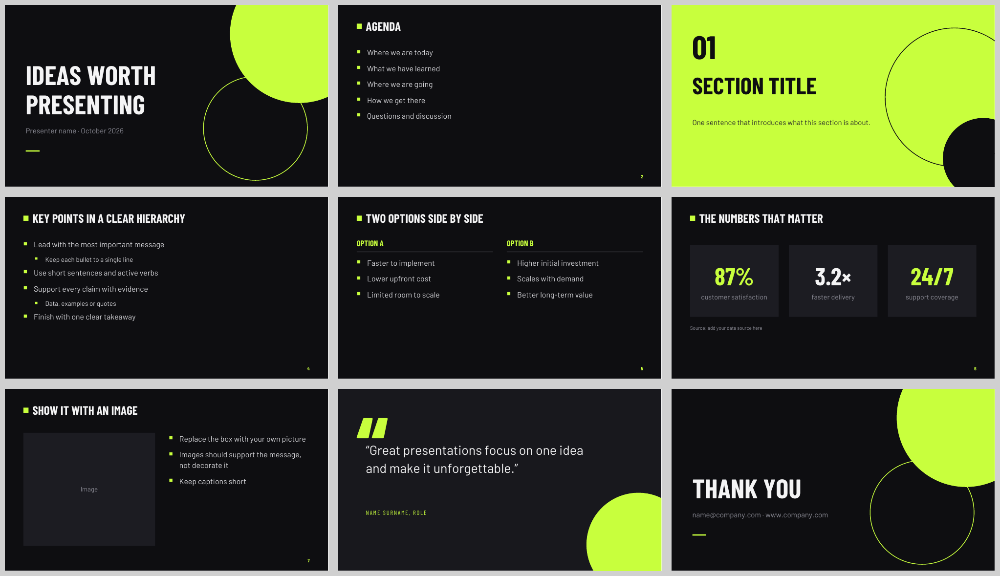
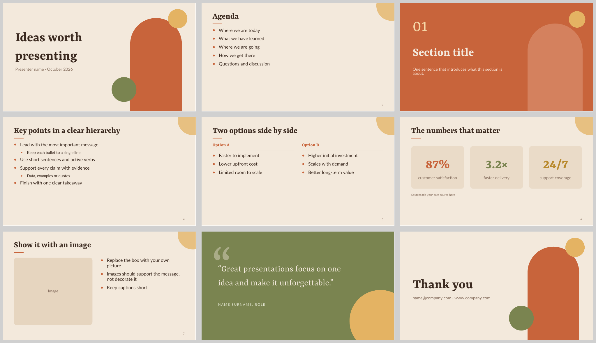
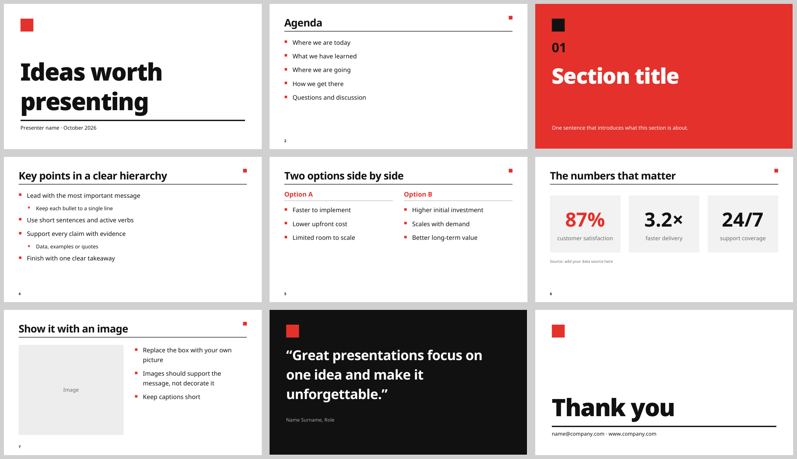
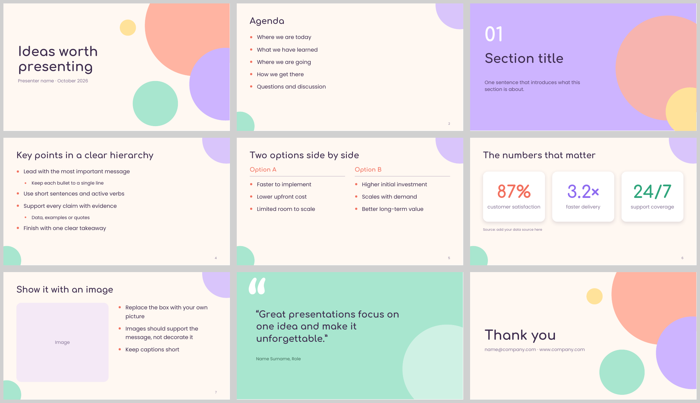
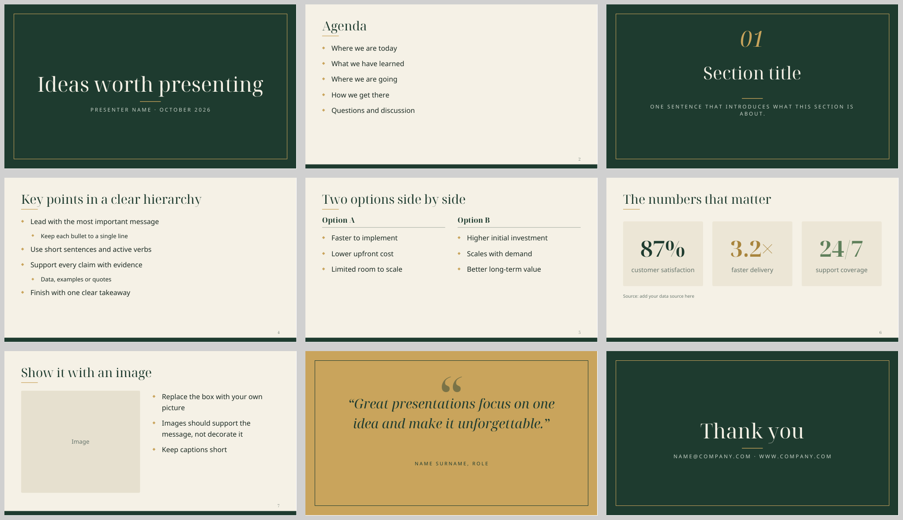
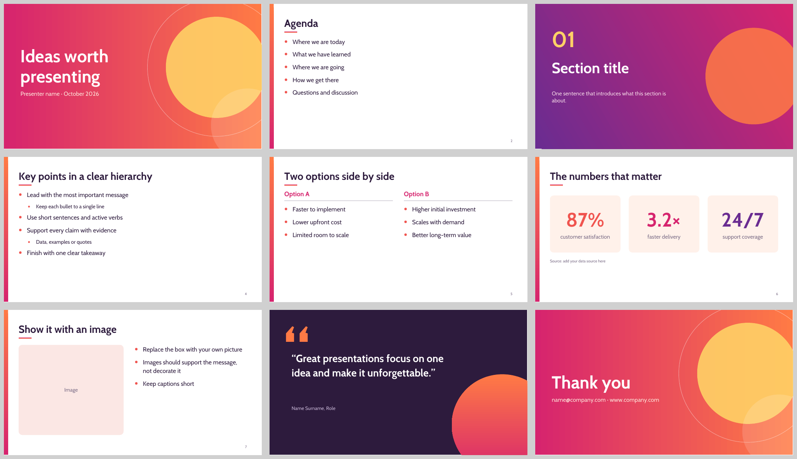
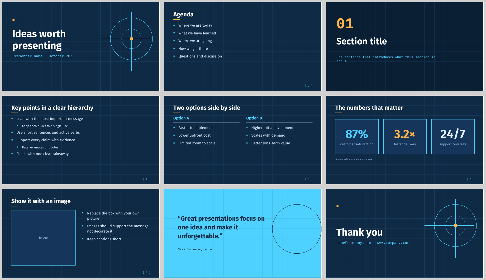

# Modern LibreOffice Impress Templates

Ten modern, ready-to-use presentation templates for **LibreOffice Impress** (`.otp`). 

Everything is free: the templates are released into the public domain under [CC0](LICENSE), and all fonts are licensed under the [SIL Open Font License](https://openfontlicense.org/). Use them for anything you like.

Each template is a complete design system:

- **Four master slides:** Title, Section, Content and Accent (for quotes and key messages)
- **Styled placeholders:** titles, subtitles and bullets on all levels use the theme's fonts and colours, so new slides look right automatically
- **Footer and page-number fields** that work with *Insert ▸ Header and Footer*
- **Nine example slides:** title, agenda, section divider, bullet hierarchy, two columns, stat cards, image + text, quote and closing slide, each with a usage tip in the speaker notes
- **Embedded fonts (all SIL OFL):** the templates look the same on machines that don't have the fonts installed
- **16:9** widescreen format

## The templates

| Template | Style | Fonts |
|---|---|---|
| [Aurora](#aurora) | Deep navy with glowing teal, violet and pink gradients | Lato |
| [Paper](#paper) | Editorial off-white, classic serif headlines, vermilion accent | Playfair Display, Lato |
| [Fjord](#fjord) | Crisp corporate blue and white | Noto Sans |
| [Midnight](#midnight) | Near-black, electric lime, bold condensed capitals | Barlow Condensed, Barlow |
| [Terracotta](#terracotta) | Warm sand, terracotta arches, olive and ochre | Rasa, Lato |
| [Swiss](#swiss) | International Typographic Style: huge type, one red square | Noto Sans |
| [Sorbet](#sorbet) | Soft pastel bubbles and rounded type | Comfortaa, Poppins |
| [Forest](#forest) | Forest green, cream and gold, framed and elegant | Noto Serif Display, Noto Sans |
| [Sunset](#sunset) | Vivid orange-to-magenta gradients with a retro sun | Cabin |
| [Blueprint](#blueprint) | Engineering grid, cyan linework, monospace details | Fira Sans, Fira Mono |

### Aurora

### Paper

### Fjord

### Midnight

### Terracotta

### Swiss

### Sorbet

### Forest

### Sunset

### Blueprint

## Installation

**Quick use:** double-click any `.otp` file. LibreOffice opens a new, untitled presentation based on the template.

**Add them to LibreOffice's template manager:**

1. Download the `.otp` files (or clone this repository).
2. In LibreOffice, open **File ▸ Templates ▸ Manage Templates** (`Ctrl+Shift+N`).
3. Click **Import**, choose the **Presentations** category and select the `.otp` files.
4. The templates now show up when you create a new presentation, including in Impress's *Select a Template* dialog.

**Manual install:** copy the `.otp` files into your user template folder:

| OS | Folder |
|---|---|
| Linux | `~/.config/libreoffice/4/user/template/` |
| Windows | `%APPDATA%\LibreOffice\4\user\template\` |
| macOS | `~/Library/Application Support/LibreOffice/4/user/template/` |

Tested with LibreOffice 7.6. Older versions open the files too, but may render some effects (glows, text transparency, shadow blur) more simply.

## Using the templates

- **Switch slide designs:** open the *Master Slides* panel in the sidebar and click Title, Section, Content or Accent. You can also use *Slide ▸ Change Slide Master*.
- **Bullet levels:** press `Tab` / `Shift+Tab` in a bullet list.
- **Footer and slide numbers:** *Insert ▸ Header and Footer*. Slide numbers are on by default on Content slides.
- **Images:** the example image slide uses a grey box as a placeholder. Delete it and insert your image (*Insert ▸ Image*) in the same spot.
- **Stat cards** are ordinary shapes: duplicate them or edit the numbers directly.
- **Change the design for every slide:** edit the master slides in *View ▸ Master Slide*.

## Licence

**Fonts:** the embedded fonts are not covered by CC0. They keep their own licence, the [SIL Open Font License 1.1](https://openfontlicense.org/), which allows embedding, redistribution and commercial use. Each font's copyright notice and licence text is in `fonts/<Family>/OFL.txt`.

| Font | Used in |
|---|---|
| Barlow, Barlow Condensed | Midnight |
| Cabin | Sunset |
| Comfortaa | Sorbet |
| Fira Sans, Fira Mono | Blueprint |
| Lato | Aurora, Paper, Terracotta |
| Noto Sans | Fjord, Swiss, Forest |
| Noto Serif Display | Forest |
| Playfair Display | Paper |
| Poppins | Sorbet |
| Rasa | Terracotta |
